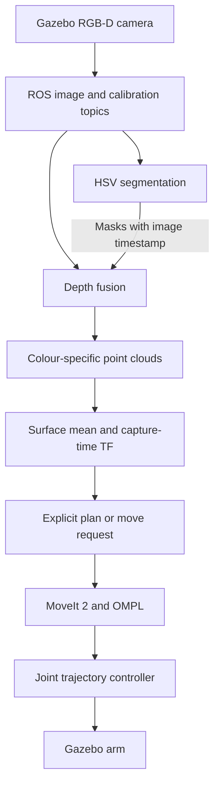

# Perception-based 5-DOF Manipulator

**An ongoing robotics project connecting RGB-D perception to motion planning in ROS 2 and Gazebo.**

I am building this project to understand the complete path from an object appearing in a camera image to a robot moving towards it. I started with a custom arm model and colour-based segmentation, then added depth processing, coordinate transformations and a MoveIt 2 interface. My next focus is learned instance segmentation and, eventually, reliable grasping.

The current arm has **four revolute joints and one prismatic joint**, with a separately controlled gripper. This is a simulation and learning project, not a completed autonomous pick-and-place system.

**Stack:** Ubuntu 24.04 · ROS 2 Jazzy · Gazebo Harmonic · Python · OpenCV · NumPy · MoveIt 2 · ros2_control

## Where to start

- [Current implementation and limitations](#current-status)
- [Build and launch commands](#build-and-run)
- [My development workflow](docs/WORKFLOW.md)
- [Detailed MoveIt interface](src/roboarm_motion/README.md)
- [Repository maintenance and verification](docs/REPOSITORY_NOTES.md)

## Current status

| Component | What is available |
| --- | --- |
| Robot and simulation | URDF/Xacro model, meshes, RGB-D sensor, table/block worlds, Gazebo and RViz launch files. |
| Joint control | Gazebo ros2_control integration, joint-state broadcaster, arm trajectory controller and separate gripper trajectory controller. |
| 2D perception | HSV segmentation of red, pink and green regions; masks, bounding boxes, pixel counts and 2D centroids published through custom ROS messages. |
| 3D perception | Exact timestamp matching of segmentation and depth, camera-intrinsic back-projection, invalid-depth filtering and colour-specific PointCloud2 outputs. |
| Motion interface | Capture-time TF transformation and explicit plan/move/cancel services using MoveIt's MoveGroup action. The goal constrains the position of `claw_link`; orientation is free. |
| Apple segmentation | Initial YOLO segmentation training on YCB apple images is documented in my development notes. Generalisation is still poor. Training scripts, weights, dataset conversion and a YOLO ROS node are not included here yet. |
| Grasping and evaluation | Still to implement: object orientation/6D pose, grasp selection, a complete pick-and-place sequence, environment collision-scene integration and quantitative evaluation. |

The supplied world contains coloured blocks; it does not yet include a packaged YCB apple asset. The launch sequence below runs the **HSV baseline**, not a YOLO apple pipeline.

## How the pipeline connects



The depth node creates 3D samples in the camera optical frame. The motion node transforms their mean into `base_link`, then adds a configurable approach height in **base-frame Z**. This point is an approach target for the claw-link origin, not a measured object centre, grasp pose or finger contact point.

## Build and run

### 1. Prepare the workspace

These commands assume ROS 2 Jazzy is already installed on Ubuntu 24.04 and `rosdep` is initialised. Use a ROS-compatible system Python environment; an unrelated virtual environment may hide ROS packages.

For a **new checkout**:

```bash
mkdir -p ~/ros2_projects
cd ~/ros2_projects
git clone https://github.com/Shoaib3786/Perception-based-manipulator-5-DOF-.git roboArm_rosws
cd roboArm_rosws
source /opt/ros/jazzy/setup.bash

sudo apt update
sudo apt install python3-colcon-common-extensions python3-rosdep \
  ros-jazzy-ros-gz ros-jazzy-gz-ros2-control ros-jazzy-moveit
rosdep update
rosdep install --from-paths src --ignore-src --rosdistro jazzy -r -y
colcon build --symlink-install
source install/setup.bash
```

If this workspace already exists, use it instead of cloning over it. Review and commit local changes before updating from GitHub. The build requires the Python `setup.py` and `setup.cfg` files included in this revision.

**In every new terminal**, run:

```bash
cd ~/ros2_projects/roboArm_rosws
source /opt/ros/jazzy/setup.bash
source install/setup.bash
```

### 2. Terminal 1 — simulation and controllers

```bash
ros2 launch roboarm_urdf_description gazebo.launch.py
```

This starts Gazebo with `perception_world2.sdf`, spawns the arm, starts `robot_state_publisher`, bridges the camera and clock topics, and spawns the three controllers. There is no need to launch another controller manager.

To select the other supplied world:

```bash
ros2 launch roboarm_urdf_description gazebo.launch.py \
  world:="$(ros2 pkg prefix --share roboarm_urdf_description)/worlds/perception_world.sdf"
```

Use only one of these simulation commands at a time.

### 3. Terminal 2 — 2D segmentation

```bash
ros2 run perception_roboarm segmentation_node --ros-args -p use_sim_time:=true
```

The OpenCV windows show the original image, accepted mask and labelled regions. This node requires a graphical desktop. Press `q` in an image window or Ctrl+C to stop it.

### 4. Terminal 3 — depth fusion

```bash
ros2 run perception_roboarm depth_node --ros-args -p use_sim_time:=true
```

The node waits for calibration and exactly matching depth/segmentation timestamps. It publishes `/perception/red/points`, `/perception/pink/points` and `/perception/green/points`, including empty clouds when a colour disappears.

### 5. Terminal 4 — MoveIt and the approach node

```bash
ros2 launch roboarm_motion gazebo_moveit.launch.py \
  rviz:=true \
  cloud_topic:=/perception/red/points \
  approach_height:=0.20
```

Set `rviz:=false` to use an existing RViz window. Starting this launch **does not move the arm automatically**.

For this baseline, select a colour topic containing **one object**. The depth node combines all regions of the same colour; their combined mean would not represent a particular object if several are present.

### 6. Terminal 5 — inspect, then request motion

First check that the controllers are active:

```bash
ros2 control list_controllers -c /controller_manager
ros2 action list
```

Expected controller names: `joint_state_broadcaster`, `joint_trajectory_controller`, `gripper_controller`. Expected actions include `/move_action` and `/joint_trajectory_controller/follow_joint_trajectory`.

Request a plan without execution:

```bash
ros2 service call /approach_node/plan std_srvs/srv/Trigger '{}'
```

In RViz, use Fixed Frame `base_link`, planning group `arm`, and inspect the planned path. Add a Marker display for `/approach_node/target_marker` with transient-local durability to see the target.

**Known limitation:** Gazebo's table and blocks are not automatically present in MoveIt's planning scene. An RViz point-cloud display does not add collision geometry. Add the environment through the planning-scene interface and verify frame alignment before relying on collision checking. The current approach is not a collision-safe grasp demonstration.

To request planning and execution:

```bash
ros2 service call /approach_node/move std_srvs/srv/Trigger '{}'
```

This uses the latest target and **replans**; it does not execute the exact previously displayed preview. A successful service response means the request was submitted. Check the motion-node log for the final MoveIt result.

To request cancellation:

```bash
ros2 service call /approach_node/cancel std_srvs/srv/Trigger '{}'
```

Keep the node running until the action result arrives. Closing its terminal is not a reliable cancellation mechanism.

### Optional tools

**To Collect images of the objects on the table for Dataset generation** in a separate session close all gazebo simulations, also use user input argument for different image size capturing.
```bash
ros2 launch roboarm_urdf_description gazebo.launch.py \
  enable_cameras:=true record_dataset:=true \
  image_width:=1920 image_height:=1080 \
  dataset_dir:="$PWD/dataset"
```

**Control robot joints using keyboard keys** in a separate session with Gazebo running:
```bash
ros2 run roboarm_motion keyboard_teleop --ros-args -p use_sim_time:=true
```

**Inspect only the robot model** in a separate session, with Gazebo stopped:

```bash
ros2 launch roboarm_urdf_description display.launch.py
```

This uses the joint-state GUI for visual inspection, not Gazebo control. Do not run it alongside the simulation because it introduces another robot-state/joint-state source.

**Open RViz without a second robot-state publisher:**

```bash
rviz2 -d "$(ros2 pkg prefix --share roboarm_urdf_description)/rviz/rviz_config_display.rviz" \
  --ros-args -p use_sim_time:=true
```

**Tune HSV thresholds** instead of running segmentation:

```bash
ros2 run perception_roboarm hsvTracking_node --ros-args -p use_sim_time:=true
```

**Inspect the ROS connections:**

```bash
ros2 topic list
ros2 topic hz /camera/color/image_raw
ros2 topic info /perception/segmentation_2d --verbose
ros2 run tf2_ros tf2_echo base_link corrected_optical_frame
```

For direct `PointStamped` XYZ targets, see the [motion package guide](src/roboarm_motion/README.md#send-xyz-directly).

## Package map

| Package | Responsibility |
| --- | --- |
| `roboarm_urdf_description` | Robot, sensor, world, bridge configuration and simulation launch. |
| `perception_interfaces` | `Segment2D` and `Segmentation2D` custom message definitions. |
| `perception_roboarm` | HSV tuning, segmentation and depth back-projection. |
| `roboarm_movit_config` | Setup Assistant's semantic model and planning configuration; the spelling is intentional here because it matches the package. |
| `roboarm_motion` | Gazebo-specific MoveIt launch and service-triggered approach client. |
| `roboarm_controller` | Earlier controller experiments; not required by the main launch sequence. |
| `roboarm_proj1` | Earlier publisher/subscriber learning exercises. |

Do not run the generated `roboarm_movit_config/demo.launch.py` beside the Gazebo integration launch: the demo can start a separate mock-hardware stack. The legacy `roboarm_controller/controller.launch.py` also references a commented-out `controller_manager` variable and is not a supported entry point.

## Topics used by this implementation

| Topic | Type | Purpose |
| --- | --- | --- |
| `/camera/color/image_raw` | `sensor_msgs/Image` | RGB image input. |
| `/camera/depth/image_raw` | `sensor_msgs/Image` | Registered depth input assumed by the fusion code. |
| `/camera/color/camera_info` | `sensor_msgs/CameraInfo` | Intrinsics for back-projection. |
| `/perception/segmentation_2d` | `perception_interfaces/Segmentation2D` | Region masks and 2D measurements. |
| `/perception/{red,pink,green}/points` | `sensor_msgs/PointCloud2` | Valid 3D samples grouped by colour. |
| `/perception/target_xyz` | `geometry_msgs/PointStamped` | Optional direct target in point-input mode. |
| `/joint_states` | `sensor_msgs/JointState` | Joint feedback for TF and MoveIt. |
| `/clock` | `rosgraph_msgs/Clock` | Shared simulation time. |

## What I am working on next

1. Improve apple segmentation using varied images, backgrounds and negative examples; evaluate on held-out scenes.
2. Add reproducible dataset conversion, training settings, model weights instructions and a ROS inference node.
3. Preserve object instances through the 3D pipeline rather than merging by colour.
4. Validate camera-frame headers, calibration and the Gazebo/world/base-frame relationship.
5. Add table/object collision geometry to the MoveIt planning scene.
6. Extend approach motion to grasp selection, gripper sequencing and pick-and-place.
7. Measure mask precision/recall and mAP, perception latency, position error and task success rate.

No measured accuracy, speed or grasp-success result is claimed yet. Launch names and interfaces have been checked against source code; a full clean build and simulation run must still be checked on the ROS 2 Jazzy machine.
