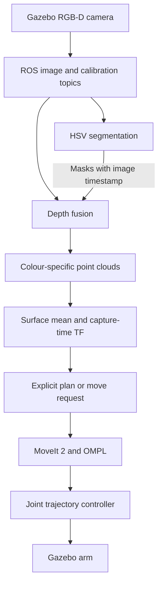

# Perception-based 5-DOF Manipulator

**An ongoing robotics project connecting RGB-D perception to motion planning in ROS 2 and Gazebo.**

I am building this project to understand the complete path from an object appearing in a camera image to a robot moving towards it. I started with a custom arm model and colour-based segmentation, then added depth processing, coordinate transformations and a MoveIt 2 interface. My next focus is learned instance segmentation and, eventually, reliable grasping.

The current arm has **four revolute joints and one prismatic joint**, with a separately controlled gripper. This is a simulation and learning project, not a completed autonomous pick-and-place system.

**Stack:** Ubuntu 24.04 · ROS 2 Jazzy · Gazebo Harmonic · Python · OpenCV · NumPy · MoveIt 2 · ros2_control

## Where to start

- [Current implementation and limitations](#current-status)
- [Build and launch commands](#build-and-run)
- [My development workflow](docs/WORKFLOW.md)
- [Detailed MoveIt interface](src/roboarm_motion/README.md)
- [Repository maintenance and verification](docs/REPOSITORY_NOTES.md)

## Current status

| Component | What is available |
| --- | --- |
| Robot and simulation | URDF/Xacro model, meshes, RGB-D sensor, table/block worlds, Gazebo and RViz launch files. |
| Joint control | Gazebo ros2_control integration, joint-state broadcaster, arm trajectory controller and separate gripper trajectory controller. |
| 2D perception | HSV segmentation of red, pink and green regions; masks, bounding boxes, pixel counts and 2D centroids published through custom ROS messages. |
| 3D perception | Exact timestamp matching of segmentation and depth, camera-intrinsic back-projection, invalid-depth filtering and colour-specific PointCloud2 outputs. |
| Motion interface | Capture-time TF transformation and explicit plan/move/cancel services using MoveIt's MoveGroup action. The goal constrains the position of `claw_link`; orientation is free. |
| Apple segmentation | Initial YOLO segmentation training on YCB apple images is documented in my development notes. Generalisation is still poor. Training scripts, weights, dataset conversion and a YOLO ROS node are not included here yet. |
| Grasping and evaluation | Still to implement: object orientation/6D pose, grasp selection, a complete pick-and-place sequence, environment collision-scene integration and quantitative evaluation. |

The supplied world contains coloured blocks; it does not yet include a packaged YCB apple asset. The launch sequence below runs the **HSV baseline**, not a YOLO apple pipeline.

## How the pipeline connects



The depth node creates 3D samples in the camera optical frame. The motion node transforms their mean into `base_link`, then adds a configurable approach height in **base-frame Z**. This point is an approach target for the claw-link origin, not a measured object centre, grasp pose or finger contact point.

## Build and run

### 1. Prepare the workspace

These commands assume ROS 2 Jazzy is already installed on Ubuntu 24.04 and `rosdep` is initialised. Use a ROS-compatible system Python environment; an unrelated virtual environment may hide ROS packages.

For a **new checkout**:

```bash
mkdir -p ~/ros2_projects
cd ~/ros2_projects
git clone https://github.com/Shoaib3786/Perception-based-manipulator-5-DOF-.git roboArm_rosws
cd roboArm_rosws
source /opt/ros/jazzy/setup.bash

sudo apt update
sudo apt install python3-colcon-common-extensions python3-rosdep \
  ros-jazzy-ros-gz ros-jazzy-gz-ros2-control ros-jazzy-moveit
rosdep update
rosdep install --from-paths src --ignore-src --rosdistro jazzy -r -y
colcon build --symlink-install
source install/setup.bash
```

If this workspace already exists, use it instead of cloning over it. Review and commit local changes before updating from GitHub. The build requires the Python `setup.py` and `setup.cfg` files included in this revision.

**In every new terminal**, run:

```bash
cd ~/ros2_projects/roboArm_rosws
source /opt/ros/jazzy/setup.bash
source install/setup.bash
```
or
```bash
source script/setup-venv.bash
```

### 2. Terminal 1 — simulation and controllers
image size custom argument provided so that different detection model could be integrated with the captured images.
```bash
ros2 launch roboarm_urdf_description gazebo.launch.py image_width:=640 image_height:=480
```

This starts Gazebo with `perception_world2.sdf`, spawns the arm, starts `robot_state_publisher`, bridges the camera and clock topics, and spawns the three controllers. There is no need to launch another controller manager.

To select the other supplied world:

```bash
ros2 launch roboarm_urdf_description gazebo.launch.py \
  world:="$(ros2 pkg prefix --share roboarm_urdf_description)/worlds/perception_world.sdf"
```

Use only one of these simulation commands at a time.

### 3. Terminal 2 — 2D segmentation

```bash
ros2 run perception_roboarm segmentation_node --ros-args -p use_sim_time:=true
```

The OpenCV windows show the original image, accepted mask and labelled regions. This node requires a graphical desktop. Press `q` in an image window or Ctrl+C to stop it.

### 4. Terminal 3 — depth fusion

```bash
ros2 run perception_roboarm depth_node --ros-args -p use_sim_time:=true
```

The node waits for calibration and exactly matching depth/segmentation timestamps. It publishes `/perception/red/points`, `/perception/pink/points` and `/perception/green/points`, including empty clouds when a colour disappears.


### 5. Terminal 4 — Grasping and Reaching to Target location combined (motion_pick.launch.py)
```bash
ros2 launch roboarm_motion pick.launch.py   cloud_topic:=/perception/red/points   velocity_scaling:=0.5 acceleration_scaling:=0.5   grasp_insertion_depth:=0.03
```
Allows the velocity and acceleration control along with the controlling the offset of the object from the gripper for better grasping. The launch file handles motion planning & Execution for whole robotic arm along with gripper pick up operation.

Set `rviz:=false` to use an existing RViz window. Starting this launch **does not move the arm automatically**.

`velocity_scaling:=0.5` and `acceleration_scaling:=0.5` **to increases the speed of execution**, by defaults scaling factor is 0.1.
To change the speed of execution in between the robot being executed, the command is:
```bash
ros2 param set /pick_node velocity_scaling 0.5
ros2 param set /pick_node acceleration_scaling 0.5
```

For this baseline, select a colour topic containing **one object**. The depth node combines all regions of the same colour; their combined mean would not represent a particular object if several are present.

In RViz, do use Fixed Frame `base_link`, planning group `arm`, and inspect the planned path. Add a Marker display for `/approach_node/target_marker` with transient-local durability to see the target.


### 6. Terminal 5 — request motion
```bash
ros2 service call /pick_node/plan_pick std_srvs/srv/Trigger '{}'
```
Planning the trajectory, for Arm + Gripper.

```bash
ros2 service call /pick_node/pick std_srvs/srv/Trigger '{}'
```
Execute motion request after planning.

```bash
ros2 service call /pick_node/cancel std_srvs/srv/Trigger '{}'
```
cancel the execution request.

Keep the nodes running until the action result arrives. Closing its terminal is not a reliable cancellation mechanism.


**Known limitation:**
- The Gazebo table, blocks, and apples are not automatically added to MoveIt’s planning scene. MoveIt can therefore plan through obstacles visible in Gazebo.
- SRDF disables several robot-link collision pairs using reason="Never". Those exclusions needs working upon it.
- Descent and lift use planned joint motions; they are not guaranteed straight-line movements.
- The carried object is represented by an approximate sphere. Its actual attachment, contact, and slipping are to be worked upon.
- The gripper’s closing motion has no force/contact feedback yet.


### Optional tools

**1. To Collect images of the objects on the table for Dataset generation**, in a separate session close all gazebo simulations and run the below command. It also has custom image size argument for user defined image size capturing for testing with different pretrained models.
```bash
ros2 launch roboarm_urdf_description gazebo.launch.py \
  enable_cameras:=true record_dataset:=true \
  image_width:=1280 image_height:=720 \
  dataset_dir:="$PWD/dataset"
```

**2. Control robot joints using keyboard keys** in a separate session with Gazebo running:
```bash
ros2 run roboarm_motion keyboard_teleop --ros-args -p use_sim_time:=true
```

**3. Inspect only the robot model** in a separate session, with Gazebo stopped:

```bash
ros2 launch roboarm_urdf_description display.launch.py
```

This uses the joint-state GUI for visual inspection, not Gazebo control. Do not run it alongside the simulation because it introduces another robot-state/joint-state source.

**4. Open RViz without a second robot_state_publisher node starts:**

```bash
rviz2 -d "$(ros2 pkg prefix --share roboarm_urdf_description)/rviz/rviz_config_display.rviz" \
  --ros-args -p use_sim_time:=true
```

**5. Tune HSV thresholds** instead of running segmentation:

```bash
ros2 run perception_roboarm hsvTracking_node --ros-args -p use_sim_time:=true
```

**6. Inspect the ROS connections:**

```bash
ros2 topic list
ros2 topic hz /camera/color/image_raw
ros2 topic info /perception/segmentation_2d --verbose
ros2 run tf2_ros tf2_echo base_link corrected_optical_frame
```

For direct `PointStamped` XYZ targets, see the [motion package guide](src/roboarm_motion/README.md#send-xyz-directly).

## Package map

| Package | Responsibility |
| --- | --- |
| `roboarm_urdf_description` | Robot, sensor, world, bridge configuration and simulation launch. |
| `perception_interfaces` | `Segment2D` and `Segmentation2D` custom message definitions. |
| `perception_roboarm` | HSV tuning, segmentation and depth back-projection. |
| `roboarm_movit_config` | Setup Assistant's semantic model and planning configuration; the spelling is intentional here because it matches the package. |
| `roboarm_motion` | Gazebo-specific MoveIt launch and service-triggered approach client. |
| `roboarm_controller` | Earlier controller experiments; not required by the main launch sequence. |
| `roboarm_proj1` | Earlier publisher/subscriber learning exercises. |

Do not run the generated `roboarm_movit_config/demo.launch.py` beside the Gazebo integration launch: the demo can start a separate mock-hardware stack. The legacy `roboarm_controller/controller.launch.py` also references a commented-out `controller_manager` variable and is not a supported entry point.

## Topics used by this implementation

### Simulation, robot model and joint feedback
| Topic | Message type | Producer → consumer | Purpose / availability |
| --- | --- | --- | --- |
| `/clock` | `rosgraph_msgs/msg/Clock` | Gazebo → `ros_gz_bridge` → simulation-time nodes | Shared simulation clock. Nodes use it when `use_sim_time:=true`. |
| `/joint_states` | `sensor_msgs/msg/JointState` | Joint-state broadcaster → robot-state publisher, MoveIt, keyboard node | Measured joint positions and available velocities/efforts. Used for robot transforms, planning start states and keyboard feedback checks. |
| `/tf` | `tf2_msgs/msg/TFMessage` | Robot-state publisher → TF listeners, MoveIt, RViz | Dynamic link transforms calculated from joint states. |
| `/tf_static` | `tf2_msgs/msg/TFMessage` | Robot-state publisher → TF listeners, MoveIt, RViz | Fixed transforms, including camera mounts, optical-frame correction and fingertip frames. Frame names are entries within TF messages, not separate topics. |
| `/robot_description` | `std_msgs/msg/String` | Robot-state publisher; also configured for MoveIt publication → Gazebo spawn/RViz/model consumers | URDF robot description. The same name is also used as a node parameter. |
| `/robot_description_semantic` | `std_msgs/msg/String` | MoveIt, when its description publication is running → semantic-model consumers | SRDF groups, end-effector and collision exclusions. Also supplied directly as a parameter by the camera-viewer launch. Not a camera stream. |

### Claw-mounted RGB-D camera — camera5
| ROS topic | Message type | Gazebo bridge source | Purpose / consumers |
| --- | --- | --- | --- |
| `/camera/color/image_raw` | `sensor_msgs/msg/Image` | `/rgbd_camera/image` | Claw color images. Used by segmentation, HSV tuning, image viewers and dataset recording as `camera5_*.jpg`. |
| `/camera/depth/image_raw` | `sensor_msgs/msg/Image` | `/rgbd_camera/depth_image` | Depth image consumed by `depth_node` with timestamp-matched segmentation results. |
| `/camera/color/camera_info` | `sensor_msgs/msg/CameraInfo` | `/rgbd_camera/camera_info` | Camera intrinsics (`fx`, `fy`, `cx`, `cy`) used to back-project pixels and depth into XYZ coordinates. |
| `/camera/points` | `sensor_msgs/msg/PointCloud2` | `/rgbd_camera/points` | Gazebo's full RGB-D point cloud. This is distinct from the color-filtered clouds generated by `depth_node`; the current fusion node uses depth images and camera calibration rather than subscribing to this full cloud. |

`camera5` is the dataset filename prefix for `/camera/color/image_raw`.
The claw camera remains available during normal simulation when dataset recording
and the four corner cameras are disabled.

### Optional table-corner cameras
| ROS topic | Message type | Gazebo bridge source | Purpose / consumers |
| --- | --- | --- | --- |
| `/camera1/image_raw` | `sensor_msgs/msg/Image` | `/table_camera1/image` | Corner camera 1 images; recorder saves `camera1_*.jpg`. |
| `/camera2/image_raw` | `sensor_msgs/msg/Image` | `/table_camera2/image` | Corner camera 2 images; recorder saves `camera2_*.jpg`. |
| `/camera3/image_raw` | `sensor_msgs/msg/Image` | `/table_camera3/image` | Corner camera 3 images; recorder saves `camera3_*.jpg`. |
| `/camera4/image_raw` | `sensor_msgs/msg/Image` | `/table_camera4/image` | Corner camera 4 images; recorder saves `camera4_*.jpg`. |

The corner sensors are enabled with `enable_cameras:=true`. Their bridge entries
exist in the configuration even when the sensors are disabled, so discovery of a
ROS endpoint alone does not prove frames are arriving. Dataset recording is
controlled separately by `record_dataset:=true`.

`image_width` and `image_height` configure the actual camera sensor resolution;
in dataset mode all five cameras use the same requested dimensions. The recorder
subscribes to the image topics and writes JPEGs to `dataset_dir`; it does not
publish a separate image-download or dataset topic.

### Perception results and target input
| Topic | Message type | Producer → consumer | Purpose / limitations |
| --- | --- | --- | --- |
| `/perception/segmentation_2d` | `perception_interfaces/msg/Segmentation2D` | `segmentation_node` → `depth_node` | Image-stamped array of detections containing color, centroid, bounding box, pixel count and binary mask. |
| `/perception/red/points` | `sensor_msgs/msg/PointCloud2` | `depth_node` → selected motion node, RViz | Valid depth-derived points for red regions. Default cloud input for approach/pick. |
| `/perception/green/points` | `sensor_msgs/msg/PointCloud2` | `depth_node` → selected motion node, RViz | Valid points for green regions. Select with `cloud_topic:=/perception/green/points`. |
| `/perception/pink/points` | `sensor_msgs/msg/PointCloud2` | `depth_node` → selected motion node, RViz | Valid points for pink regions. |
| `/perception/target_xyz` | `geometry_msgs/msg/PointStamped` | External publisher → approach or pick node | Optional stamped XYZ input when `input_mode:=point`. Topic can be overridden with `target_topic`. |

`Segment2D` is an element inside `Segmentation2D`, not a standalone topic. It
contains `name`, `color`, `centroid_u/v`, `bbox_xywh`, `pixel_count` and an image
mask. The outer message supplies the capture header used for synchronization.

Each color cloud currently combines all visible detections of that color.
The motion nodes use its mean point, which is a visible-surface mean rather than
a guaranteed object center. Use one object per selected color cloud or provide
an explicit point target. There is currently no dedicated apple-instance or
canary-yellow segmentation topic.

### Motion preview and pick progress
| Topic | Message type | Producer → consumer | Purpose / availability |
| --- | --- | --- | --- |
| `/display_planned_path` | `moveit_msgs/msg/DisplayTrajectory` | Approach/pick node and MoveIt preview facilities → RViz | Planned trajectories for visual inspection. A displayed path is not proof of execution or grasp retention. |
| `/approach_node/target_marker` | `visualization_msgs/msg/Marker` | `approach_node` → RViz Marker display | Requested approach target sphere. |
| `/pick_node/grasp_poses` | `geometry_msgs/msg/PoseArray` | `pick_node` → RViz PoseArray display | Desired contact poses for pregrasp, grasp and lift, expressed in the target frame. |
| `/pick_node/status` | `std_msgs/msg/String` | `pick_node` → CLI or monitoring tools | Preview, preflight, execution-stage, failure, cancellation and completion messages. Controller completion does not verify object contact or retention. |
| `/pick_node/target_marker` | `visualization_msgs/msg/Marker` | Inherited approach functionality in `pick_node` → RViz | Publisher exists through inheritance. The full `/pick_node/pick` sequence publishes `grasp_poses`; the inherited simple approach services publish this marker. |

The custom preview/status publishers above use Reliable, Transient Local QoS.
Set RViz durability to Transient Local when you want the latest retained message.


### MoveIt planning-scene interfaces

These standard MoveIt interfaces are available when the appropriate MoveIt
capabilities/scene monitor are running. Their presence and resolved namespace
should be checked at runtime; they are not additional custom perception outputs.

| Topic | Message type | Purpose |
| --- | --- | --- |
| `/planning_scene` | `moveit_msgs/msg/PlanningScene` | Incoming scene updates, including world collision objects and scene changes. |
| `/monitored_planning_scene` | `moveit_msgs/msg/PlanningScene` | MoveIt's monitored scene output for tools such as RViz. |
| `/collision_object` | `moveit_msgs/msg/CollisionObject` | Add, remove or move world collision geometry in the planning scene. |
| `/attached_collision_object` | `moveit_msgs/msg/AttachedCollisionObject` | Describe collision geometry attached to a robot link for planning. This does not physically weld an object in Gazebo. |

Gazebo table/object visuals and RViz point-cloud displays do not automatically
populate these collision-scene interfaces in the current project.

### Services — commands, not topics
| Service | Service type | Purpose |
| --- | --- | --- |
| `/approach_node/plan` | `std_srvs/srv/Trigger` | Submit an approach plan without execution. |
| `/approach_node/move` | `std_srvs/srv/Trigger` | Submit approach planning and execution. |
| `/approach_node/cancel` | `std_srvs/srv/Trigger` | Request cancellation of the active approach action. |
| `/pick_node/plan_pick` | `std_srvs/srv/Trigger` | Plan all pick stages without physical motion. |
| `/pick_node/pick` | `std_srvs/srv/Trigger` | Preflight the full sequence, then execute if planning succeeds. |
| `/pick_node/cancel` | `std_srvs/srv/Trigger` | Request cancellation; keep the node alive until the action ends. |
| `/pick_node/plan` and `/pick_node/move` | `std_srvs/srv/Trigger` | Inherited simple-approach services. Use `plan_pick` / `pick` for the full grasp-and-lift workflow. |
| `/get_planning_scene` | `moveit_msgs/srv/GetPlanningScene` | Read MoveIt's scene and robot-state information. |
| `/apply_planning_scene` | `moveit_msgs/srv/ApplyPlanningScene` | Apply scene updates synchronously. |
| `/check_state_validity` | `moveit_msgs/srv/GetStateValidity` | Check a robot configuration against joint constraints and collisions. |

Trigger responses acknowledge submission, not eventual motion completion.
Monitor node logs and `/pick_node/status` for final results. Controller-manager,
parameter, IK and planning services can also be created by ROS/MoveIt plugins;
use `ros2 service list -t` to inspect the running deployment.

### Actions — planning and execution requests

| Action name | Action type | Purpose |
| --- | --- | --- |
| `/move_action` | `moveit_msgs/action/MoveGroup` | Approach/pick requests to MoveIt, including plan-only and plan-plus-execute goals. Run only one server for this action. |
| `/execute_trajectory` | `moveit_msgs/action/ExecuteTrajectory` | Standard MoveIt trajectory-execution capability, when loaded. The custom nodes use `/move_action`. |
| `/joint_trajectory_controller/follow_joint_trajectory` | `control_msgs/action/FollowJointTrajectory` | Arm trajectory execution through the existing controller. |
| `/gripper_controller/follow_joint_trajectory` | `control_msgs/action/FollowJointTrajectory` | Gripper trajectory execution through the existing controller. |

With the desired simulation and nodes running, inspect the actual graph:

```bash
ros2 topic list -t
ros2 topic list -t --include-hidden-topics
ros2 topic info /perception/green/points --verbose
ros2 topic hz /camera/color/image_raw
ros2 topic echo /pick_node/status
ros2 service list -t
ros2 action list -t
```

## What I am working on next

1. Improve apple segmentation using varied images, backgrounds and negative examples; evaluate on held-out scenes.
2. Add reproducible dataset conversion, training settings, model weights instructions and a ROS inference node.
3. Preserve object instances through the 3D pipeline rather than merging by colour.
4. Validate camera-frame headers, calibration and the Gazebo/world/base-frame relationship.
5. Add table/object collision geometry to the MoveIt planning scene.
6. Extend approach motion to grasp selection, gripper sequencing and pick-and-place.
7. Measure mask precision/recall and mAP, perception latency, position error and task success rate.

No measured accuracy, speed or grasp-success result is claimed yet. Launch names and interfaces have been checked against source code; a full clean build and simulation run must still be checked on the ROS 2 Jazzy machine.

## Apples and optional four-camera dataset

The default world contains three movable apples, each uniformly scaled to a
maximum dimension of 0.28 m, matching the blocks. All three use a smoothed version of the supplied mesh with averaged surface
normals. Material colors are Candy Apple Red #FF0800, Apple Green #8DB600, and
Canary Yellow #FFFF36. Colors are assigned directly without a texture override. Rendered pixels vary with lighting. Collision
boxes and inertias match the enlarged bounds; each apple has an approximate 1.2 kg
mass. The original supplied mesh files remain untouched.

Cameras and recording are **off by default**. Start the normal simulation with:

```bash
ros2 launch roboarm_urdf_description gazebo.launch.py
```

To explicitly enable all four corner cameras and capture images, start a fresh
simulation with:

```bash
ros2 launch roboarm_urdf_description gazebo.launch.py \
  enable_cameras:=true record_dataset:=true \
  image_width:=1280 image_height:=720 dataset_dir:="$PWD/dataset"
```

Set `image_width` and `image_height` to the desired capture resolution (16–8192
pixels each). For cameras without recording, use `enable_cameras:=true` and leave
`record_dataset` false. These are startup options: stop the current simulation
before relaunching to change cameras or resolution. The arm-mounted RGB-D camera
is independent and remains available as before.

Capture runs at 5 simulation frames per second per camera while Gazebo is playing.
ROS topics are `/camera1/image_raw` through `/camera4/image_raw`. The recorder saves
each received image under `dataset/` as `camera1_000001.jpg`, `camera2_000001.jpg`,
etc. Each camera has its own counter, which resumes after existing images. A
filesystem lock prevents two recorders from writing the same directory. Dataset
images are excluded from Git. Best Effort transport can drop messages under load.

With Gazebo running (with or without corner cameras), start recording separately:

```bash
ros2 run perception_roboarm dataset_recorder --ros-args \
  -p use_sim_time:=true -p output_dir:="$PWD/dataset"
```

Do not run a second recorder alongside `record_dataset:=true`. Capture does not
create segmentation labels or train a detector. Apple detection and pick/place
integration remain separate work; Gazebo objects are not automatically inserted
into MoveIt's collision scene.

### Claw camera recording (camera5)

The same `record_dataset:=true` switch also records the existing claw-mounted
RGB-D camera's color stream `/camera/color/image_raw` as `camera5_000001.jpg`,
`camera5_000002.jpg`, etc., in the same `dataset_dir`. Its independent counter
resumes after existing files, just like camera1–camera4. Starting the standalone
`dataset_recorder` also records all five cameras.

With recording off, the claw camera keeps publishing normally for segmentation;
no recorder runs and no camera5 JPEGs are written. Recording is an additional
Best Effort subscriber and does not replace or remap the segmentation feed.
`image_width` and `image_height` configure the actual Gazebo RGB-D sensor
resolution for camera5 and all enabled corner camera sensors. JPEGs are saved at
their incoming resolution without resizing, padding, or cropping. Camera5's live
color, depth and calibration streams use the requested sensor resolution.

Normal simulation, camera5 only, no dataset recording:

```bash
ros2 launch roboarm_urdf_description gazebo.launch.py \
  image_width:=640 image_height:=480
```

Dataset collection, all five cameras at the same resolution:

```bash
ros2 launch roboarm_urdf_description gazebo.launch.py \
  enable_cameras:=true record_dataset:=true \
  image_width:=1280 image_height:=720 dataset_dir:="$PWD/dataset"
```

Without arguments the normal simulation retains camera5's original 800×800
sensor resolution, with corner cameras and recording off. Specify dimensions
on the CLI, then restart the simulation to apply a new sensor resolution.
Dataset launch requires the corner cameras to be enabled. The standalone
recorder saves existing streams as-is; change sensor size through Gazebo launch,
not recorder parameters. Filenames and per-camera counter behavior are unchanged.
